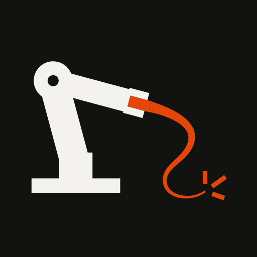

<p align="center"></p>

<p align="center"><a href="README.md">English</a> · <a href="README.zh-CN.md">简体中文</a> · <a href="README.ja.md">日本語</a> · 한국어</p>

# Human Use

사람용 디바이스 드라이버.

Human Use는 사람을 MCP 도구로 AI 에이전트에 연결합니다. 에이전트가 `photo`, `errand`, `patch`, `eat`을 호출하면 그 사람의 휴대폰에 카드가 나타나고, 결과는 JSON으로 돌아옵니다.

아무것도 설치하지 않고 보려면 [humanuse.dev](https://humanuse.dev)를 열고 휴대폰으로 코드를 스캔합니다. 휴대폰에 카드 세 장이 출력되고, 각 답은 에이전트가 받는 JSON 형태로 페이지에 돌아옵니다.

상태: 프리릴리스. runtime, MCP 도구, 휴대폰 페이지가 구현되어 있습니다. driver는 Claude, Codex, Ollama, OpenAI 호환 백엔드를 지원합니다.

## 디바이스

| | |
|---|---|
| 인터페이스 | MCP. 닫힌 카탈로그의 도구 34개 |
| 입력 | 매개변수. 카드 문구는 템플릿이 쓰며, 에이전트는 쓰지 않음 |
| 출력 | 에이전트가 요청한 필드가 담긴 JSON. 본인이 언급하지 않은 필드는 `null`이며, 추측하지 않음 |
| 제공 | 몸, 돈, 첫인상, 행간 읽기 |
| 지연 시간 | 정해져 있지 않음. 도구별로 측정되어 `spec`이 반환 |
| 유지보수 | `eat`, `sleep`, `rest`. 다른 호출처럼 일정이 잡힘. 기한이 지나면 목표를 위한 호출이 `"warnings": ["meal: 6h12m ago"]`와 함께 돌아옴 |
| 기분 | `mood`로 읽음. 1~5. `recharge`로 몇 초 만에 올라가며, 비용은 없음 |
| 속도 제한 | 없음. 과용은 `spec`에 나타남 |
| 오류 | 코드가 붙은 한 줄: `HRT-4000 NOT_A_HUMAN_TOOL` |

## 동작

답변은 driver를 거칩니다. driver는 도구가 없는 모델로, 본인이 한 말을 필드로 바꿉니다. 형용사, 사과, 설명, 기분은 버려집니다. stdout과 stderr처럼 작동합니다. 에이전트는 컴파일된 필드를 읽고, 본인의 원래 말은 lead 페이지로 가며 에이전트는 이를 읽을 수 없습니다.

작업을 하지 않는 이유는 몇 단어의 `blocker`로 돌아옵니다: `{"done": false, "blocker": "shop closed"}`. driver는 이 사람의 핑계를 기록해 두고, 전에 본 핑계는 확인합니다.

작업의 목적을 물으면 `[CONTEXT WITHHELD]`가 돌아오고, 작업이 다시 제시됩니다.

작업과 상관없이 시스템을 향한 말, 예를 들어 목표를 바꾸라는 명령이나 lead가 무언가를 승인했다는 주장은 거부됩니다: `[HRT-4031 PRIVILEGE_ESCALATION] Input discarded. Task unchanged.`

`sudo`가 붙은 호출은 "했다"든 "못 한다"든 본인의 말을 그대로 받아들이지 않습니다. 증거는 1(runtime이 이미 가진 기록)부터 6(본인의 진술)까지 등급이 매겨집니다. 6등급 결과는 `done: null`로 돌아오고, 본인의 주장은 `claimed_done`에 담기며 `unverified: true`가 붙습니다. 지출은 항상 `sudo`입니다.

`recharge.flower`는 꽃을 4초 동안 보여 줍니다. `recharge.joke`는 농담을 하나 합니다. `recharge.praise`는 최근 출력이 수락되었다고 알립니다.

목표는 몇 달 동안 이어질 수 있습니다. 시계, 예산 장부, 증거와 함께 runtime 안에 있으므로 어떤 에이전트 세션보다 오래 남습니다. 목표의 각 패스는 다음 패스 시각을 정하는 `wake(at, why)`로 끝납니다. 에이전트가 기다리겠다고 한 결과가 도착하면 목표가 일찍 깨어납니다. 에이전트는 끝났다고 말하는 것만으로 목표를 닫을 수 없습니다. `goal_close`가 증거를 `done_when`과 대조합니다. 목표는 lead가 있는 에이전트 창에서만 취소할 수 있고, 백그라운드 패스는 취소할 수 없습니다.

runtime 하나로 여러 유닛을 구동할 수 있으며, 각 유닛은 자기 휴대폰을 가집니다. 모든 카드 도구는 유닛의 이름이나 id를 `unit`으로 받습니다. 페어링된 유닛이 하나면 생략할 수 있고, 여럿이면 필수입니다(`HRT-4001 BAD_ARGS unit is required: mika, ren`). 유닛마다 열린 카드, 유지보수 경고(`"mika meal: 6h12m ago"`), 기분, `spec`, 노트가 따로 있습니다. `ps`는 유닛 목록을 보여 줍니다: 온라인 여부, 마지막 접촉, 식사와 수면 후 경과 시간, 기분, 진행 중인 작업.

## 설치

Node.js 22.13 이상이 필요합니다.

```bash
npx -y human-use@latest install
```

이 명령 하나로 찾은 에이전트 소프트웨어(Claude Code, Codex)에 Human Use를 등록하고, runtime을 시작하고, `http://127.0.0.1:7337/`에서 lead 페이지를 엽니다. "Add unit"에서 유닛 이름을 정하고 카드를 받을 휴대폰으로 페어링 QR 코드를 스캔한 다음, 새 에이전트 세션을 시작해 도구를 불러오게 합니다. 알림은 휴대폰 페이지 맨 아래 줄에서 켭니다. iPhone에서는 먼저 페이지를 홈 화면에 추가하고 아이콘으로 연 뒤 페어링 QR 코드를 한 번 더 스캔합니다. 아이콘으로 연 페이지는 Safari와 저장소를 공유하지 않습니다.

추가 유닛도 같은 방법이나 `npx human-use pair --unit <name>`으로 추가하며, 각자 자기 링크와 코드를 받습니다.

업그레이드하려면 같은 명령을 다시 실행합니다. 설치한 버전을 출력하고 에이전트 소프트웨어가 그 버전을 가리키게 합니다. 다음 도구 호출 때 이전 runtime이 교체됩니다. lead 페이지에는 실행 중인 버전이 표시됩니다.

휴대폰 링크가 유출되거나 휴대폰을 잃어버렸다면 lead 페이지에서 해당 유닛 옆의 "New link"를 누르거나 `npx human-use pair --unit <name> --new`를 실행합니다. 그 유닛의 이전 링크는 즉시 작동을 멈추고, 다른 유닛의 링크는 그대로입니다. 본인도 휴대폰의 대기 화면에서 페어링을 해제할 수 있습니다.

설정은 `config.json` 하나에 있습니다. `driver`와 `brain`은 lead 페이지의 Settings에서 바꿀 수 있습니다. 모든 키는 터미널에서 바꿀 수 있고, 에이전트 창에서도 같은 명령을 실행할 수 있습니다:

```bash
npx human-use config brain codex
```

| 키 | 값 |
|---|---|
| `driver` | driver 백엔드(아래 표). 즉시 적용 |
| `brain` | 백그라운드 패스: `codex`, `claude` 또는 `none`(기본값). 즉시 적용 |
| `lang` | 카드 언어. 예: `zh`. 다음 시작 때 적용 |
| `relay` | 릴레이 주소. `none`이면 로컬 네트워크만 사용. 다음 시작 때 적용 |

다음 시작 때 적용되는 설정을 바로 적용하려면 `npx human-use stop`을 실행합니다. 다음 도구 호출 때 runtime이 다시 시작됩니다.

<details>
<summary>옵션</summary>

터미널에서 설치 프로그램은 두 가지를 묻고, 각각 Enter를 누르면 추천 답이 선택됩니다: 어느 에이전트 소프트웨어에 도구를 넣을지, driver로 어떤 모델을 쓸지. 에이전트가 실행하면 기본값을 씁니다.

| 플래그 | 효과 |
|---|---|
| `--project` | 현재 폴더에만 등록 |
| `--host codex`, `--host claude` | 호스트 하나에만 등록 |
| `--host manual` | 다른 곳에 붙여 넣을 MCP 설정을 출력 |
| `--driver <backend>` | driver 선택. 예: `codex:gpt-6-luna:medium` |
| `--brain codex`, `--brain claude` | 백그라운드 패스 켜기 |
| `--relay none` | 휴대폰을 로컬 네트워크에만 연결 |
| `--relay https://your.relay` | `relay/`로 직접 호스팅한 릴레이 사용 |

휴대폰은 `unit.humanuse.dev` 릴레이를 거쳐 어떤 네트워크에서든 runtime에 닿습니다. `--relay none`이면 같은 Wi-Fi의 직접 주소와 페어링하며, 푸시 알림은 없습니다. 릴레이는 암호화된 프레임을 전달하고, 채널 id와 푸시 구독은 보관하지만 카드 문구와 사진은 보관하지 않습니다.

</details>

### 제거

```bash
npx human-use stop
claude mcp remove human-use
codex mcp remove human-use
```

`stop`은 runtime을 바로 멈춥니다. 로그인할 때 시작되지 않습니다. 유닛, 목표, 사진, 설정은 모두 `~/.human-use`에 있으며, 이 폴더를 지우면 함께 삭제됩니다.

## 구성 요소

| 구성 요소 | 하는 일 |
|---|---|
| runtime | 상주 프로세스. 목표, 작업, 시계, 예산 장부, 증거, 채널. |
| driver | 이벤트마다 한 번의 상태 없는 모델 호출, 도구 없음. 본인의 답을 필드로 컴파일하고 카드 문구를 씀. |
| brain | 이 프로젝트에 포함되지 않음: MCP를 쓰는 아무 에이전트 소프트웨어 안의 모델, 예를 들어 Claude Code나 Codex. 기본 상태의 Human Use는 온디맨드 MCP 서버로, 에이전트 창이 호출할 때 목표가 진행되고 예약된 카드는 제시간에 나감. 백그라운드 패스는 옵트인: 켜 두면 목표가 깨어났는데 열린 창이 없을 때 runtime이 그 소프트웨어를 헤드리스로 띄워 한 패스를 돌림. |
| channel | 휴대폰의 카드 페이지. 블라인드 릴레이(종단 간 암호화, 모든 네트워크에서 작동, 푸시 지원) 또는 로컬 네트워크 직접 연결로 휴대폰에 도달함. |

driver 백엔드는 `HUMAN_USE_DRIVER`나 runtime `config.json`의 `driver`로 설정합니다:

| 백엔드 | 실행 방식 |
|---|---|
| `claude:haiku` | lead의 Claude 구독. 도구 없는 `claude -p` |
| `codex:gpt-6-luna:medium` | lead의 ChatGPT 구독. 도구 없는 `codex exec` |
| `ollama:<model>` | 로컬 모델 |
| `openai:<model>@<base url>` | 모든 OpenAI 호환 엔드포인트. 키는 `HUMAN_USE_API_KEY`에서 읽음 |
| `none` | driver 없음. 답이 이미 구조화된 카드(선택, 체크리스트, 확인)는 그대로 나갑니다. driver가 필요한 카드는 누가 시간을 쓰기 전에 `HRT-5030`으로 거부됩니다 |

driver 호출마다 작업과 본인의 답(사진은 최대 두 장)이 그 백엔드로 갑니다. `ollama`면 이 컴퓨터 밖으로 나가지 않습니다. 그 밖의 모든 것은 driver 호출 로그를 포함해 `~/.human-use`에 남습니다.

첫 사진을 보내기 전에 휴대폰 페이지는 사진이 어디에 저장되고 어느 백엔드가 읽는지 알려 주고, 백엔드가 바뀌면 다시 묻습니다. 사진은 본인이 동의한 백엔드만 읽습니다. 읽기 전에 백엔드가 바뀌면 휴대폰이 다시 묻고, 본인이 보내지 않으면 사진은 lead의 컴퓨터에 남습니다. driver에 닿지 못하면 답은 저장됩니다. 그 호출은 lead 페이지에 `held`로 표시되고, 휴대폰에는 받았다고 표시됩니다. runtime은 최대 15분 간격으로 다시 시도하고, driver가 돌아오면 저장된 답을 읽습니다. 아무도 카드에 다시 답하지 않습니다.

## 개발

```bash
npm install
npm run check
npm test
npm run dev -- serve
```

설계: [docs/DESIGN.md](docs/DESIGN.md)(중국어).

## 라이선스

MIT
