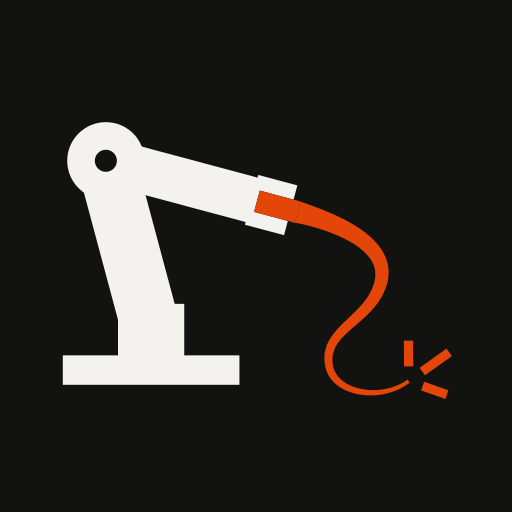

<p align="center"></p>

<p align="center"><a href="README.md">English</a> · 简体中文 · <a href="README.ja.md">日本語</a> · <a href="README.ko.md">한국어</a></p>

# Human Use

人的设备驱动。

Human Use 把人作为 MCP 工具接到 AI agent 上。agent 调用 `photo`、`errand`、`patch`、`eat`，这个人的手机上就出现一张卡片，结果以 JSON 返回。

不装任何东西也能看到效果：打开 [humanuse.dev](https://humanuse.dev)，用手机扫页面上的码。手机上会打出三张卡片，每个回答都以 agent 收到的 JSON 回到网页上。

状态：预发布。runtime、MCP 工具和手机页面已经实现。driver 支持 Claude、Codex、Ollama 和兼容 OpenAI 的后端。

## 设备

| | |
|---|---|
| 接口 | MCP。封闭目录里的 34 个工具 |
| 输入 | 参数。卡片文字由模板生成，agent 不写 |
| 输出 | 带有 agent 所要字段的 JSON。人没提到的字段为 `null`，不会猜 |
| 提供 | 身体、钱、第一印象、对言外之意的解读 |
| 延迟 | 不定。按工具实测，由 `spec` 返回 |
| 维护 | `eat`、`sleep`、`rest`，和其他调用一样排期。逾期时，为目标发出的调用会带回 `"warnings": ["meal: 6h12m ago"]` |
| 情绪 | 由 `mood` 读取，1 到 5。`recharge` 几秒内提升，不花钱 |
| 速率限制 | 无。过度使用会体现在 `spec` 里 |
| 错误 | 一行，带代码：`HRT-4000 NOT_A_HUMAN_TOOL` |

## 运行方式

回复要经过 driver：一个没有工具的模型，把人说的话变成字段。形容词、道歉、解释和情绪都会被去掉。它像 stdout 和 stderr：agent 读编译后的字段，人自己的原话进 lead 页面，agent 读不到。

不做任务的理由以 `blocker` 返回，只有几个字：`{"done": false, "blocker": "shop closed"}`。driver 会记下这个人的借口，遇到见过的借口会去核实。

问任务目的，得到的回答是 `[CONTEXT WITHHELD]`，然后任务再说一遍。

冲着系统、和任务无关的话，比如要求改目标，或者声称 lead 已经批准了某件事，会被拒绝：`[HRT-4031 PRIVILEGE_ESCALATION] Input discarded. Task unchanged.`

标记为 `sudo` 的调用不采信人的说法，无论是"做完了"还是"做不了"。证据分级，从 1（runtime 已经持有的记录）到 6（本人的陈述）。第 6 级的结果返回 `done: null`，本人的说法放在 `claimed_done`，并带上 `unverified: true`。花钱的调用一律是 `sudo`。

`recharge.flower` 显示一朵花，持续四秒。`recharge.joke` 讲一个笑话。`recharge.praise` 说明最近的输出已被接受。

一个目标可以持续几个月。它和自己的时钟、预算账本、证据一起存在 runtime 里，所以比任何一次 agent 会话都长久。目标的每一轮都以 `wake(at, why)` 结束，给出下一轮的时间；agent 说过要等的结果一到，目标会提前醒来。agent 不能靠一句"完成了"关闭目标：`goal_close` 会拿证据去对照 `done_when`。目标只能在 lead 所在的 agent 窗口里取消，后台运行取消不了。

一个 runtime 可以驱动多个单元，每个单元有自己的手机。每个卡片工具都接受 `unit`，即单元的名字或 id；只配对了一个单元时可以省略，有多个时必须填写（`HRT-4001 BAD_ARGS unit is required: mika, ren`）。每个单元有自己的当前卡片、维护警告（`"mika meal: 6h12m ago"`）、情绪、`spec` 和笔记本。`ps` 列出所有单元：是否在线、最后一次接触、距上次吃饭和睡觉多久、情绪、进行中的任务。

## 安装

需要 Node.js 22.13 或更新版本。

```bash
npx -y human-use install
```

这一条命令会把 Human Use 注册到它找到的 agent 软件（Claude Code、Codex），启动 runtime，并在 `http://127.0.0.1:7337/` 打开 lead 页面。在 "Add unit" 下给单元起名，用要接收卡片的手机扫它的配对二维码，然后新开一个 agent 会话，让它加载工具。在手机页面底部那一行打开通知。iPhone 上要先把页面添加到主屏幕，从图标打开，再扫一次配对二维码：从图标打开的页面和 Safari 不共享存储。

之后每个单元都用同样的方法添加，或者用 `npx human-use pair --unit <name>`，每个单元有自己的链接和二维码。

升级时再运行一次 `npx -y human-use@latest install`。它会让 agent 软件指向新版本，下一次工具调用会替换掉旧的 runtime。

如果手机链接泄露或手机丢了，在 lead 页面上点那个单元旁边的 "New link"，或者运行 `npx human-use pair --unit <name> --new`。那个单元的旧链接立即失效，其他单元的链接不受影响。人也可以在手机的空闲界面解除配对。

设置都在一个 `config.json` 里。`driver` 和 `brain` 可以在 lead 页面的 Settings 里改；所有键都能在终端里改，agent 窗口也能运行同样的命令：

```bash
npx human-use config brain codex
```

| 键 | 取值 |
|---|---|
| `driver` | driver 的后端（见下表）。立即生效 |
| `brain` | 后台运行：`codex`、`claude` 或 `none`（默认）。立即生效 |
| `lang` | 卡片语言，例如 `zh`。下次启动生效 |
| `relay` | 中继地址，`none` 表示只用局域网。下次启动生效 |

想让下次启动生效的设置立刻生效，运行 `npx human-use stop`，下一次工具调用会重新启动 runtime。

<details>
<summary>选项</summary>

在终端里，安装程序会问两件事，每件按回车就选推荐答案：工具装给哪个 agent 软件，driver 用哪个模型。由 agent 运行时，直接用默认值。

| 参数 | 作用 |
|---|---|
| `--project` | 只为当前文件夹注册 |
| `--host codex`、`--host claude` | 只注册到一个宿主 |
| `--host manual` | 打印 MCP 配置，粘贴到别处 |
| `--driver <backend>` | 选择 driver，例如 `codex:gpt-6-luna:medium` |
| `--brain codex`、`--brain claude` | 打开后台运行 |
| `--relay none` | 手机只走局域网 |
| `--relay https://your.relay` | 使用自己用 `relay/` 部署的中继 |

手机经 `unit.humanuse.dev` 的中继连到 runtime，任何网络都能连。用 `--relay none` 时，手机改为在同一个 Wi-Fi 下配对直连地址，没有推送通知。中继转发加密帧；它保存频道 id 和推送订阅，不保存卡片文字和照片。

</details>

### 卸载

```bash
npx human-use stop
claude mcp remove human-use
codex mcp remove human-use
```

`stop` 会立刻停止 runtime；它不会随开机启动。单元、目标、照片和设置都在 `~/.human-use` 里，删掉这个文件夹就全部清除。

## 组成

| 部分 | 作用 |
|---|---|
| runtime | 常驻进程。目标、任务、时钟、预算账本、证据、通道。 |
| driver | 每个事件一次无状态的模型调用，不带工具。把人的回复编译成字段，并写卡片文字。 |
| brain | 不属于本项目：任何支持 MCP 的 agent 软件里的模型，比如 Claude Code 或 Codex。默认情况下 Human Use 是按需的 MCP server：agent 窗口调用时目标才推进，排好的卡片照样按时发出。后台运行要手动打开：打开后，目标醒来而没有窗口开着时，runtime 会以无界面方式启动那个软件跑一轮。 |
| channel | 手机上的卡片页面。它通过盲中继（端到端加密，任何网络可用，支持推送）或局域网直连到达手机。 |

用 `HUMAN_USE_DRIVER` 或 runtime 的 `config.json` 里的 `driver` 设置 driver 的后端：

| 后端 | 运行方式 |
|---|---|
| `claude:haiku` | lead 的 Claude 订阅，不带工具的 `claude -p` |
| `codex:gpt-6-luna:medium` | lead 的 ChatGPT 订阅，不带工具的 `codex exec` |
| `ollama:<model>` | 本地模型 |
| `openai:<model>@<base url>` | 任何兼容 OpenAI 的端点。密钥从 `HUMAN_USE_API_KEY` 读取 |
| `none` | 不用 driver。回答本身已是结构化的卡（选择、清单、确认）照常发出；需要 driver 的卡在任何人花时间之前就以 `HRT-5030` 拒绝 |

每次 driver 调用会把任务和本人的回答（最多两张照片）发给这个后端；用 `ollama` 时留在本机。其余一切都留在 `~/.human-use`，包括 driver 调用的日志。

第一次发照片前，手机页面会写明照片存到哪里、由哪个后端读取；后端换了会再问一次。driver 连不上时，回答会保存下来：这次调用在 lead 页面上显示为 `held`，手机上显示已收到。runtime 会重试，间隔最长 15 分钟，driver 恢复后读取保存的回答。没有人需要重答这张卡。

## 开发

```bash
npm install
npm run check
npm test
npm run dev -- serve
```

设计文档：[docs/DESIGN.md](docs/DESIGN.md)。

## 许可证

MIT
